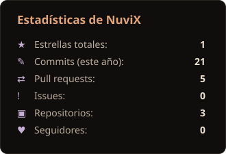

<!-- Banner -->

  

  

  
  
  

## 🌅 Sobre mí

- 🎓 Estudiante universitario con gusto por el **desarrollo web**.
- 💻 Uso **Arch Linux** con **Hyprland**, personalizado a mi manera.
- 🌱 Actualmente aprendiendo: **Python, Go y Java**.
- ⚡ Dato curioso: mi escritorio cambia de colores con cada fondo de pantalla.

## 🛠️ Tecnologías y herramientas

  

## 📊 Estadísticas

  
  

  

## 🚀 Proyectos destacados

| Proyecto | Descripción |
|---|---|
| [**Portafolio-NuviX**](https://github.com/NuviX16/Portafolio-NuviX) | Portafolio personal |
| [**Tracker-Gacha**](https://github.com/NuviX16/Tracker-Gacha) | Para las diarias y semanales |

<!-- Pie -->

  

