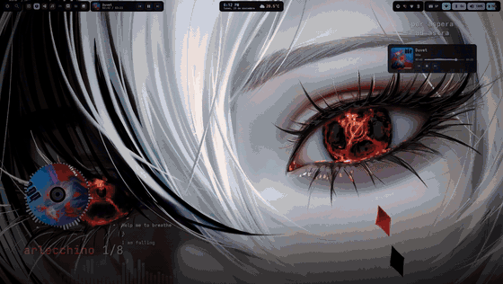
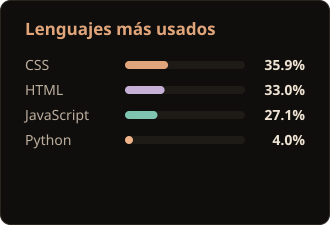

<!-- Banner -->

  

  

  
  
  

## 🌅 Sobre mí

- 🎓 **TSU en Desarrollo de Software Multiplataforma** y estudiante de **Ingeniería ITIID**.
- 🚀 Mención honorífica **Local Impact** en el **NASA Space Apps Challenge 2026** con el equipo *Gravizen* (proyecto **Vitalis**).
- 🤖 Tengo un **bot de Discord** corriendo 24/7 en **Google Cloud** que habla con un agente en mi laptop.
- 🎨 Mi escritorio en **Arch + Hyprland** cambia de colores con cada fondo animado: 29 temas, todo el sistema sincronizado.
- 🎮 Lo que sigue: un juego top-down de acción hecho por mí.

  

## 🛠️ Con qué trabajo

  

## 🚀 Proyectos

| | Proyecto | Qué es |
|---|---|---|
| 🌐 | [**Portafolio**](https://nuvix16.github.io/Portafolio-NuviX/) · [código](https://github.com/NuviX16/Portafolio-NuviX) | Proyectos con video, 29 temas de color, español/inglés. HTML, CSS y JS sin frameworks |
| 🤖 | [**NuviX Bot**](https://nuvix16.github.io/Bot-NuviX/) | Bot en Python (discord.py) en una VM de Google Cloud: agenda, niveles y economía, avisos de anime y ofertas, panel web, control remoto de mi laptop |
| 🛰️ | [**Vitalis**](https://nuvix16.github.io/Portafolio-NuviX/#proyectos) | NASA Space Apps 2026 · mención honorífica Local Impact |
| 🍽️ | **PickUp&Seat** | Preventa de comida y apartado de mesa para cafeterías universitarias. Node.js, PostgreSQL, WebSockets |
| 🎨 | [**Escritorio NuviX**](https://nuvix16.github.io/Rice-NuviX/) · [código](https://github.com/NuviX16/Rice-NuviX) | Arch + Hyprland + Serpantinum: 29 temas animados, el fondo decide los colores de todo |
| ✅ | [**Tracker-Gacha**](https://nuvix16.github.io/Tracker-Gacha/) · [código](https://github.com/NuviX16/Tracker-Gacha) | Checklist de diarias para un amigo (con memes) |

## 📊 Estadísticas

  
  

  

  
  
  

<!-- Pie -->

  

